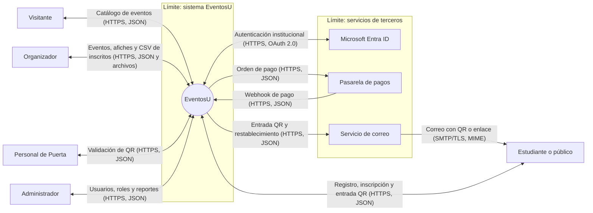
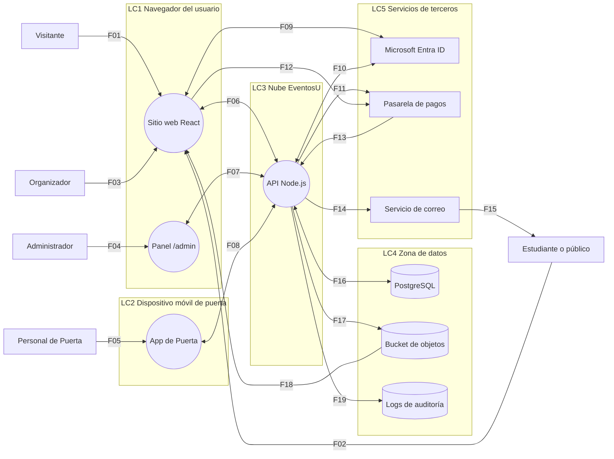

# Modelado de amenazas de EventosU

> **Estado del documento:** borrador de trabajo en Markdown. Cubre las actividades 1 a 4. Las actividades 5 (priorización) y 6 (respuesta y trazabilidad) están pendientes; al completarlas este archivo se exporta a `docs/informe.pdf`.

## 1. Portada e integrantes

| | |
|---|---|
| **Tarea** | Modelado de amenazas de un sitio web |
| **Caso** | EventosU (sitio ficticio, en fase de diseño) |
| **Integrante 1** | _Nombre completo — carné_ (GitHub: ChristianSosa22) |
| **Integrante 2** | _Nombre completo — carné_ |
| **Herramienta** | OWASP Threat Dragon 2.x, metodología STRIDE |
| **Modelo** | [`model/eventosu.json`](../model/eventosu.json) |

## 2. Alcance, activos y supuestos

### 2.1 Alcance

EventosU todavía no tiene código. Todo el análisis se razona sobre la descripción del caso y los supuestos de la sección 2.3; no se ataca ningún sistema real.

**Dentro del modelo**

| Elemento | Qué se analiza |
|---|---|
| Sitio web (React en CDN) | Manejo del token de sesión en el navegador, entrada de datos del usuario |
| Panel de administración (`/admin`) | Control de acceso por rol, gestión de usuarios |
| API (Node.js en contenedor) | Autenticación, autorización, lógica de inscripción, pago, validación de QR y exportación |
| Base de datos PostgreSQL | Integridad y confidencialidad de usuarios, inscripciones y pagos |
| Bucket de objetos | Afiches y CSV exportados |
| App de Puerta (móvil) | Validación de entradas y lo que guarda el dispositivo |
| Integraciones | Los flujos hacia y desde Microsoft Entra ID, la pasarela de pagos y el servicio de correo |
| Registros de auditoría | Dónde se guardan y quién puede alterarlos (supuesto S1) |

**Fuera del modelo**

| Elemento | Por qué queda fuera |
|---|---|
| Seguridad interna de Entra ID, la pasarela y el proveedor de correo | Son terceros; solo se modela cómo EventosU confía en lo que le envían |
| Datos de tarjeta | El caso indica que EventosU no los almacena; los procesa la pasarela (supuesto S6) |
| Infraestructura del proveedor de nube y del CDN | Responsabilidad del proveedor; sí se modela la configuración que EventosU controla (bucket, red) |
| Dispositivos personales de los usuarios | Malware en el navegador o el teléfono del estudiante no es controlable por EventosU |
| Seguridad física del recinto | Saltar una barda o entrar por otra puerta no depende del sitio web |
| Entradas falsificadas en papel sin QR | No pasan por el sistema |

### 2.2 Activos

| ID | Activo | Tipo | Valor para el negocio |
|---|---|---|---|
| A1 | Credenciales y sesiones (hashes de contraseña, JWT, clave de firma del JWT) | Dato | Quien las obtiene actúa como cualquier usuario, incluido el administrador. Su pérdida invalida la confianza en todo el sitio. |
| A2 | Datos personales de inscritos (nombre, correo, carné, teléfono) | Dato | La universidad es responsable de ellos. Una fuga expone a estudiantes a phishing y daña la reputación institucional. |
| A3 | Registros de inscripción y pago (estado "pagada", monto, referencia de la pasarela) | Dato | Son la prueba de quién pagó. Si se alteran, la universidad pierde ingresos y no puede resolver reclamos. |
| A4 | Entradas QR | Dato | Equivalen a dinero: cada QR válido es un cupo de un evento. Una entrada duplicada o falsificada deja fuera a quien sí pagó. |
| A5 | Función de validación de ingreso | Función | Si falla el día del evento se forman colas o se deja entrar sin control; es el momento más visible del servicio. |
| A6 | Catálogo de eventos y afiches | Dato | Es la cara pública de la universidad. Un afiche alterado puede difundir información falsa o enlaces maliciosos con la marca institucional. |
| A7 | CSV exportados de inscritos | Dato | Concentran en un solo archivo los datos personales de todo un evento; son el objetivo más rentable para una fuga masiva. |
| A8 | Secretos de integración (secreto del webhook, llave del servicio de correo, client secret de Entra ID, credenciales de la base de datos) | Dato | Permiten suplantar a EventosU ante terceros o a los terceros ante EventosU. |
| A9 | Roles y privilegios (función de gestión de usuarios) | Función | Deciden quién puede crear eventos, exportar datos o administrar. Un cambio indebido de rol abre todos los demás activos. |
| A10 | Registros de auditoría | Dato | Sin ellos no se puede investigar un incidente ni responder a un reclamo de pago o de ingreso. |
| A11 | Cupo de los eventos (inventario de entradas) | Función | Un evento que aparece "agotado" por reservas falsas no vende entradas reales. |

### 2.3 Supuestos

El caso no define estos puntos. Se usan de forma consistente en el DFD, las amenazas y el árbol de ataque.

| ID | Supuesto |
|---|---|
| S1 | La API escribe sus registros (accesos, cambios de rol, validaciones de QR, exportaciones) en un servicio de logs administrado de la misma nube. Se modela como un almacén separado. |
| S2 | Todo el tráfico entre componentes usa HTTPS (TLS 1.2 o superior). La conexión entre la API y PostgreSQL usa TLS dentro de la red privada de la nube. |
| S3 | "Guarda el token de sesión en el navegador" significa que el JWT está en `localStorage`, legible por cualquier JavaScript que corra en el sitio. |
| S4 | El público externo se autentica con correo y contraseña, cuyo hash se guarda en PostgreSQL. Estudiantes, organizadores, personal de puerta y administradores usan su cuenta institucional con Entra ID. |
| S5 | El rol del usuario viaja como un claim dentro del JWT que firma la API. |
| S6 | El pago se hace en una página alojada por la pasarela (redirección). EventosU nunca ve el número de tarjeta; solo recibe el resultado por webhook. |
| S7 | El QR contiene únicamente el identificador de la inscripción. La App de Puerta lo envía a la API y esta consulta la base de datos. |
| S8 | La App de Puerta necesita conexión a internet para validar; no hay modo sin conexión. |
| S9 | Hay un solo bucket para afiches y CSV. Los afiches se sirven con lectura pública para mostrarlos en el catálogo. |
| S10 | La API genera el CSV, lo guarda en el bucket y entrega al organizador un enlace de descarga. |
| S11 | La API y PostgreSQL están en la misma red privada; la base de datos no tiene dirección pública. |
| S12 | El diseño descrito no menciona verificación de firma del webhook, límites de intentos ni registro de auditoría de acciones. Se asume que **no existen** hasta que un requisito los agregue. |

## 3. DFD nivel 0 y nivel 1

El modelo está en [`model/eventosu.json`](../model/eventosu.json) y contiene dos diagramas. Las figuras de esta sección son una representación equivalente en Mermaid; **se sustituyen por las capturas de Threat Dragon antes de exportar a PDF**.

### 3.1 Nivel 0: contexto

### 3.2 Nivel 1: componentes

### 3.3 Flujos de datos del nivel 1

| ID | Origen → destino | Nombre del flujo (dato y protocolo) | Límite que cruza |
|---|---|---|---|
| F01 | Visitante → Sitio web | Consulta del catálogo (HTTPS, HTML/JS) | Usuario → LC1 |
| F02 | Estudiante o público → Sitio web | Credenciales, registro e inscripción (HTTPS, formulario) | Usuario → LC1 |
| F03 | Organizador → Sitio web | Datos del evento y afiche (HTTPS, formulario multipart) | Usuario → LC1 |
| F04 | Administrador → Panel `/admin` | Gestión de usuarios y roles (HTTPS, formulario) | Usuario → LC1 |
| F05 | Personal de Puerta → App de Puerta | Código QR escaneado (cámara, imagen QR) | Usuario → LC2 |
| F06 | Sitio web ↔ API | Peticiones y respuestas REST con JWT (HTTPS, JSON) | LC1 ↔ LC3 |
| F07 | Panel `/admin` ↔ API | Operaciones de administración con JWT (HTTPS, JSON) | LC1 ↔ LC3 |
| F08 | App de Puerta ↔ API | Validación de QR y resultado (HTTPS, JSON) | LC2 ↔ LC3 |
| F09 | Sitio web ↔ Entra ID | Solicitud y código de autorización (HTTPS, OAuth 2.0) | LC1 ↔ LC5 |
| F10 | API ↔ Entra ID | Canje de código por ID token (HTTPS, OIDC/JWT) | LC3 ↔ LC5 |
| F11 | API → Pasarela | Creación de orden de pago (HTTPS, JSON) | LC3 → LC5 |
| F12 | Sitio web → Pasarela | Redirección al checkout (HTTPS, redirect 302) | LC1 → LC5 |
| F13 | Pasarela → API | Webhook de pago (HTTPS, JSON) | LC5 → LC3 |
| F14 | API → Servicio de correo | Entrada QR y enlace de restablecimiento (HTTPS, JSON) | LC3 → LC5 |
| F15 | Servicio de correo → Estudiante o público | Correo con QR o enlace (SMTP/TLS, MIME) | LC5 → usuario |
| F16 | API ↔ PostgreSQL | Consultas y resultados SQL (TLS, protocolo PostgreSQL) | LC3 ↔ LC4 |
| F17 | API → Bucket | Afiches y CSV exportados (HTTPS, API de objetos) | LC3 → LC4 |
| F18 | Bucket → Sitio web | Descarga de afiche o CSV (HTTPS, archivo) | LC4 → LC1 |
| F19 | API → Logs de auditoría | Eventos de auditoría (HTTPS, JSON) | LC3 → LC4 |

### 3.4 Límites de confianza

| ID | Límite | Por qué cambia la confianza |
|---|---|---|
| LC1 | Navegador del usuario | El código React y el JWT viven en un equipo que controla el usuario. Todo lo que llega desde aquí puede estar manipulado. |
| LC2 | Dispositivo móvil de puerta | El teléfono puede perderse, prestarse o analizarse; lo que la app guarde se considera extraíble. |
| LC3 | Nube EventosU | Único lugar donde corre código que la universidad controla. Aquí se toman todas las decisiones de autorización. |
| LC4 | Zona de datos | Solo la API debería hablar con estos almacenes. Su configuración (bucket público, permisos de logs) es responsabilidad de EventosU. |
| LC5 | Servicios de terceros | EventosU no controla estos sistemas. Debe verificar que un mensaje realmente viene de ellos antes de actuar. |

## 4. Tabla de amenazas

23 amenazas. Distribución: Spoofing 5, Tampering 6, Repudiation 3, Information disclosure 4, Denial of service 2, Elevation of privilege 3. Once involucran un flujo que cruza un límite de confianza (columna "Flujo que cruza límite").

Flujos obligatorios: **webhook de pago** (T01, T07), **validación del QR** (T05, T11, T12, T18, T20, T23) y **exportación del CSV** (T10, T15, T16).

Las columnas impacto, probabilidad, riesgo, respuesta, mitigación y estado se completan en las actividades 5 y 6; en [`amenazas.csv`](amenazas.csv) ya existen con el valor "Pendiente".

<!-- TABLA_AMENAZAS:INICIO -->
| ID | Elemento | STRIDE | Escenario | Flujo que cruza límite |
|---|---|---|---|---|
| T01 | Pasarela de pagos (emisor del webhook) | Spoofing | Un estudiante que crea una inscripción y deja el pago pendiente encuentra la URL del webhook (la ruta es predecible y aparece en la documentación pública de la pasarela). Envía con `curl` un JSON "pago aprobado" con su número de inscripción. La API no comprueba que el mensaje venga de la pasarela, marca la inscripción como pagada y le envía el QR por correo: obtiene una entrada sin pagar. | F13 |
| T02 | API (inicio de sesión institucional) | Spoofing | Un atacante envía a un organizador un enlace de "iniciar sesión con tu cuenta institucional" en el que cambió el `redirect_uri` por un dominio suyo. Si el registro de la aplicación en Entra ID acepta comodines, o la API no valida `state` ni usa PKCE, el atacante recibe el código de autorización, lo canjea y obtiene una sesión de organizador con acceso a las listas de inscritos. | F09 |
| T03 | API (inicio de sesión con correo y contraseña) | Spoofing | Un atacante prueba contra el endpoint de login miles de pares correo y contraseña filtrados de otros sitios. El diseño no limita intentos ni exige segundo factor al público externo, así que entra a las cuentas que reutilizan contraseña y descarga sus entradas QR. | No |
| T04 | API (restablecimiento de contraseña) | Spoofing | Un atacante pide restablecer la contraseña de una víctima y altera la cabecera `Host` de la petición. La API arma el enlace con ese valor, el servicio de correo lo entrega a la víctima y, cuando ella hace clic, el token de restablecimiento llega al servidor del atacante, que toma la cuenta. | F15 |
| T05 | API (validación de QR) | Spoofing | Un asistente con una entrada legítima decodifica su QR y ve que solo contiene el número de inscripción `1042`. Genera con cualquier app un QR con `1041`, llega temprano y la API responde "válido": entra con la entrada de otra persona, que al llegar recibe "ya usado". | F08 |
| T06 | Flujo Sitio web ↔ API (inscripción) | Tampering | Un usuario intercepta con un proxy la petición de inscripción que sale de su navegador y cambia el campo de precio de 500 a 1. La API confía en el monto que envía el cliente al crear la orden en la pasarela; el usuario paga 1 y recibe una entrada de 500. | F06 |
| T07 | Flujo Pasarela → API (webhook de pago) | Tampering | Un usuario crea dos inscripciones: una a un taller de 10 y otra a un concierto de 500. Paga la barata y reenvía la notificación cambiando la referencia por la de la inscripción cara. La API solo revisa que el estado sea "pagado" y no compara monto ni orden contra lo que ella misma creó, así que marca como pagado el concierto. | F13 |
| T08 | Bucket de objetos (afiches) | Tampering | Un organizador, o alguien con su cuenta, sube un afiche y controla el nombre del objeto en la petición. Usa la ruta del afiche de otro evento y lo sobrescribe con una imagen que anuncia un cambio de sede falso y un QR de "pago" que lleva a una cuenta suya. Los visitantes ven el afiche falso con la marca de la universidad. | No |
| T09 | PostgreSQL | Tampering | Un visitante sin cuenta escribe SQL en el buscador del catálogo. La API concatena el texto en la consulta, y el atacante ejecuta un `UPDATE` que pone en "pagada" su inscripción o cambia el cupo de un evento. | No |
| T10 | Flujo Sitio web ↔ API (registro, dato que termina en el CSV) | Tampering | Una persona se registra con el nombre `=HYPERLINK("http://sitio-falso/login";"Ver detalle")`. La API guarda el texto tal cual y lo escribe en el CSV. Cuando el organizador abre el archivo en Excel, la celda se interpreta como fórmula y lo lleva a una página que le pide sus credenciales institucionales. | F06 |
| T11 | API (validación de QR) | Tampering | Dos amigos comparten la captura de pantalla de un solo QR y lo presentan al mismo tiempo en dos puertas. La API consulta el estado y después lo actualiza en dos pasos separados; ambas peticiones leen "no usado" y las dos puertas reciben "válido". Entran dos personas con una entrada. | No |
| T12 | App de Puerta | Repudiation | Todo el personal de puerta comparte un mismo usuario genérico en la app. Un miembro del personal escanea por adelantado las entradas de sus conocidos o deja pasar gente sin escanear. Cuando un asistente reclama que su entrada aparece "ya usada", no se puede saber quién la validó, en qué puerta ni con qué teléfono, y el responsable lo niega. | No |
| T13 | Panel de administración | Repudiation | Un administrador le asigna rol de organizador a un cómplice, este exporta la lista de inscritos y el administrador le quita el rol. Como los cambios de rol no dejan registro, el administrador niega haberlo hecho y no hay evidencia para contradecirlo. | No |
| T14 | Logs de auditoría | Repudiation | Un atacante que ya comprometió la API usa la misma credencial con la que el contenedor escribe logs, que también permite borrar, y elimina las entradas de sus exportaciones de CSV. La universidad no puede determinar qué datos salieron ni notificar a los afectados. | No |
| T15 | Flujo Bucket → Sitio web (descarga del CSV) | Information disclosure | El CSV de inscritos se guarda en el mismo bucket de lectura pública que los afiches, con un nombre predecible como `export-evento-87.csv`. Cualquier persona en internet prueba números de evento en la URL y descarga nombre, correo, carné y teléfono de todos los inscritos, sin iniciar sesión. | F18 |
| T16 | API (exportación de inscritos) | Information disclosure | El organizador del evento 87 cambia el identificador en la URL de exportación por 88. La API comprueba que tiene rol de organizador pero no que el evento sea suyo, y le entrega los datos personales de los inscritos de un evento ajeno. | No |
| T17 | Sitio web | Information disclosure | Un organizador malicioso escribe un `<script>` en la descripción de su evento. El sitio la muestra sin escapar y el script se ejecuta en el navegador de cada persona que abre el evento, lee el JWT de `localStorage` y lo envía al atacante. Como `/admin` es el mismo sitio, si un administrador abre el evento el atacante obtiene un token de administrador. | No |
| T18 | Flujo App de Puerta ↔ API (resultado de la validación) | Information disclosure | La respuesta de validación devuelve el registro completo de la inscripción (nombre, correo, carné, teléfono) aunque la app solo necesita "válido" o "ya usado". Alguien del personal de puerta, o quien encuentre un teléfono de puerta desbloqueado, envía números de inscripción consecutivos y recolecta los datos personales de todos los asistentes. | F08 |
| T19 | API (inscripción) | Denial of service | Un revendedor ejecuta un script el minuto en que abre la inscripción de un concierto y crea miles de inscripciones sin pagarlas. Cada una reserva un cupo sin fecha de vencimiento, el evento aparece agotado y los estudiantes reales no pueden inscribirse. | No |
| T20 | Flujo App de Puerta ↔ API (validación de QR) | Denial of service | Media hora antes de un concierto, un atacante inunda de peticiones el endpoint de validación, que no limita la tasa, o la red wifi del recinto se satura. Como la app no tiene modo sin conexión, el personal no puede validar ninguna entrada: se forma una cola de cientos de personas o se decide dejar pasar sin escanear. | F08 |
| T21 | Panel de administración | Elevation of privilege | Un estudiante con sesión normal escribe `/admin` en la barra de direcciones. El sitio oculta el menú de administración solo en el navegador y los endpoints de administración únicamente verifican que el JWT sea válido, no el rol. El estudiante llama al endpoint de roles y se asigna el rol de administrador. | No |
| T22 | API (verificación del JWT) | Elevation of privilege | Un usuario registrado decodifica su JWT, cambia el claim de rol a `admin` y lo firma de nuevo: adivina una clave HS256 débil con un diccionario, o envía el token con `alg: none` y la API lo acepta. Obtiene control total de usuarios, eventos y exportaciones. | No |
| T23 | App de Puerta | Elevation of privilege | Un atacante descarga la App de Puerta, la descompila y encuentra una llave de API fija, compartida por todos los dispositivos. Con ella llama directamente a la API desde su computadora y marca como usada o disponible cualquier entrada, sin ser personal de puerta. | F08 |
<!-- TABLA_AMENAZAS:FIN -->

## 5. Árbol de ataque: "entrar a un evento sin pagar"

Los nodos **O** se cumplen con cualquiera de sus hijos; los nodos **Y** necesitan todos. Cada hoja indica la amenaza relacionada y el costo estimado para el atacante. El camino más barato está resaltado en rojo.

```mermaid
flowchart TD
    G["OBJETIVO: entrar a un evento sin pagar"]
    G --- GO{{O}}
    GO --- R1["1. Conseguir que una inscripción propia quede como pagada"]
    GO --- R2["2. Entrar con la entrada de otra persona"]
    GO --- R3["3. Pasar la puerta sin una validación real"]
    GO --- R4["4. Obtener privilegios y emitirse una entrada"]

    R1 --- R1O{{O}}
    R1O --- N11["1.1 Falsificar el webhook de pago (T01)"]
    R1O --- N12["1.2 Alterar el monto o la referencia del pago"]
    R1O --- N13["1.3 Inyectar SQL en el buscador y poner la inscripción en pagada (T09) · costo medio"]
    N11 --- N11Y{{Y}}
    N11Y --- L111["Crear una inscripción y dejarla pendiente · costo nulo"]
    N11Y --- L112["Conocer la URL del webhook · costo bajo"]
    N11Y --- L113["Enviar un JSON de pago aprobado sin firma · costo bajo"]
    N12 --- N12O{{O}}
    N12O --- L121["Cambiar el precio en la petición de inscripción (T06) · costo bajo, paga 1"]
    N12O --- L122["Pagar el evento barato y cambiar la referencia (T07) · costo medio, paga 10"]

    R2 --- R2O{{O}}
    R2O --- N21["2.1 Generar un QR con un número de inscripción ajeno (T05)"]
    R2O --- N22["2.2 Usar dos veces un mismo QR (T11)"]
    R2O --- N23["2.3 Tomar la cuenta de otro usuario y descargar su QR"]
    N21 --- N21Y{{Y}}
    N21Y --- L211["Decodificar un QR propio para conocer el formato · costo bajo"]
    N21Y --- L212["Generar el QR con un número vecino · costo bajo"]
    N21Y --- L213["Llegar antes que el dueño de la entrada · costo medio"]
    N22 --- N22Y{{Y}}
    N22Y --- L221["Un cómplice paga una entrada y comparte la captura · costo medio"]
    N22Y --- L222["Escanear al mismo tiempo en dos puertas · costo medio"]
    N23 --- N23O{{O}}
    N23O --- L231["Probar contraseñas filtradas (T03) · costo medio"]
    N23O --- L232["Envenenar el enlace de restablecimiento (T04) · costo alto"]

    R3 --- R3O{{O}}
    R3O --- L31["3.1 Acuerdo con alguien del personal de puerta (T12) · costo medio"]
    R3O --- N32["3.2 Forzar el ingreso manual"]
    N32 --- N32Y{{Y}}
    N32Y --- L321["Saturar el endpoint de validación (T20) · costo medio"]
    N32Y --- L322["El personal decide dejar pasar sin escanear · fuera del control del atacante"]

    R4 --- R4Y{{Y}}
    R4Y --- N41["4.1 Obtener rol de administrador"]
    R4Y --- L42["4.2 Marcar la inscripción propia como pagada desde el panel · costo bajo"]
    N41 --- N41O{{O}}
    N41O --- L411["Llamar a los endpoints de /admin sin verificación de rol (T21) · costo bajo"]
    N41O --- L412["Forjar un JWT con rol admin (T22) · costo alto"]

    classDef barato fill:#ffe0e0,stroke:#c00000,stroke-width:3px,color:#000
    class G,GO,R1,R1O,N11,N11Y,L111,L112,L113 barato
    linkStyle 0,1,5,6,9,10,11,12 stroke:#c00000,stroke-width:3px
```

### Camino más barato

**Objetivo → 1 → 1.1: falsificar el webhook de pago (T01).**

| Criterio | Camino 1.1 (webhook falso) | Alternativa más cercana |
|---|---|---|
| Dinero | Cero. No se paga nada. | 1.2 exige pagar al menos 1 o 10; 2.2 exige que alguien pague una entrada completa. |
| Conocimiento | Saber enviar una petición HTTP con `curl` o Postman. | 1.3 y 4.1 (T22) requieren técnica de inyección o criptografía. |
| Acceso previo | Solo una cuenta normal, que cualquiera puede crear. | 3.1 necesita un cómplice dentro del personal. |
| Presencia y tiempo | Se hace desde casa, días antes del evento. | 2.1 y 2.2 dependen de llegar antes que otro o de sincronizarse en dos puertas. |
| Rastro | La entrada resultante es indistinguible de una pagada; en la puerta no hay nada sospechoso. | 2.1 deja a una víctima que reclama en la puerta. |
| Repetible | Sí: sirve para cualquier evento y cualquier cantidad de entradas, y se puede revender. | 2.2 da una sola entrada extra por cada entrada pagada. |

Las tres hojas de 1.1 son de costo nulo o bajo y ninguna depende de otra persona. El único dato que el atacante debe averiguar es la URL del webhook, y las pasarelas publican el formato de sus notificaciones. Por eso la verificación de la firma del webhook es el control con mejor relación costo-beneficio de todo el modelo: cierra el camino más barato con un cambio pequeño en la API.

El segundo camino más barato es 4.1 con T21 (endpoints de `/admin` sin verificación de rol), que también es gratuito y remoto, pero requiere descubrir los endpoints de administración y deja un cambio de rol visible para otros administradores.

## 6. Matriz de riesgo

_Pendiente: actividad 5._

## 7. Trazabilidad de las 5 amenazas críticas

_Pendiente: actividad 6._

## 8. Conclusiones

_Pendiente: se redactan al terminar las actividades 5 y 6._
